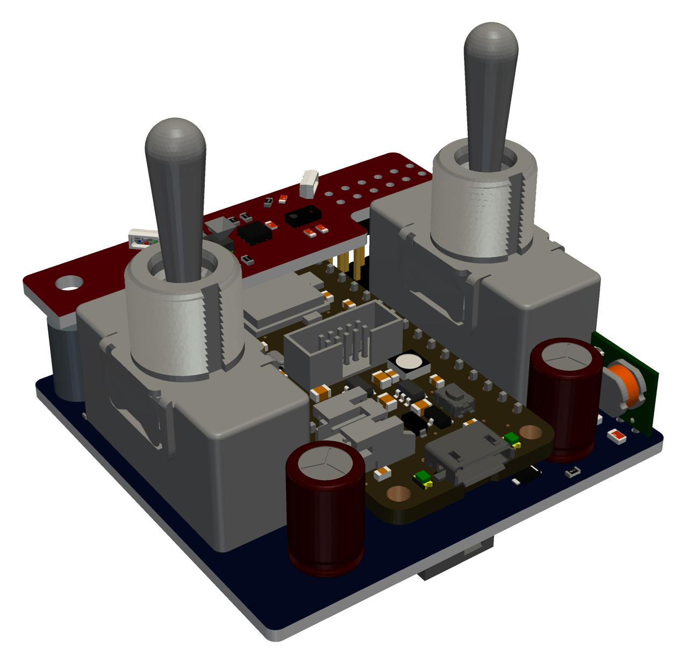
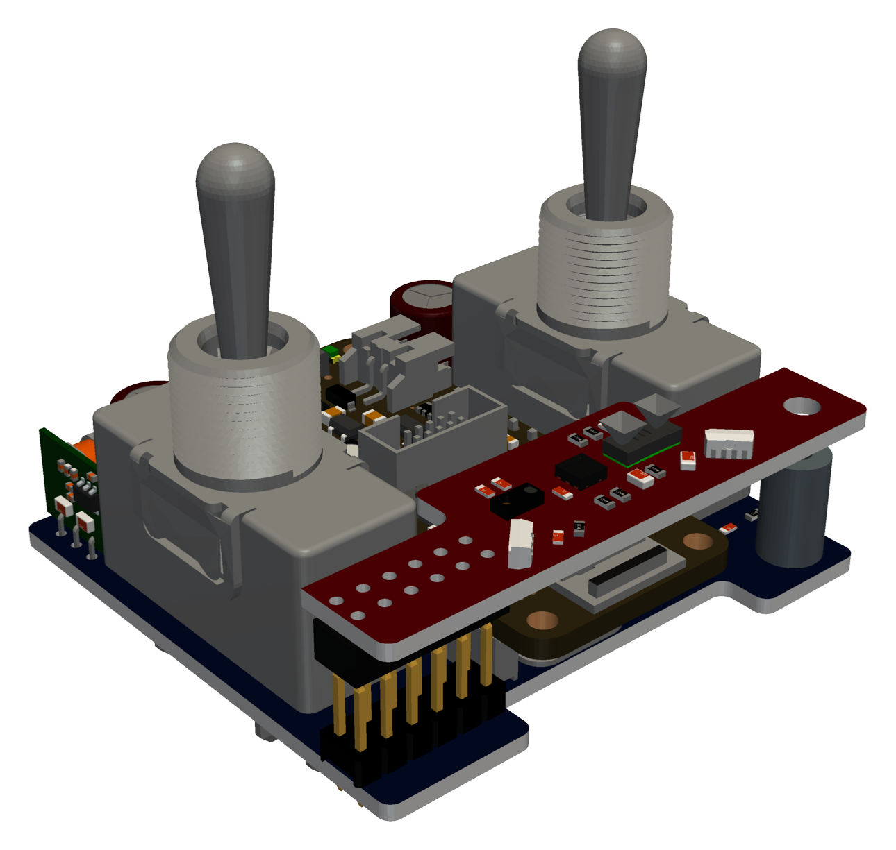
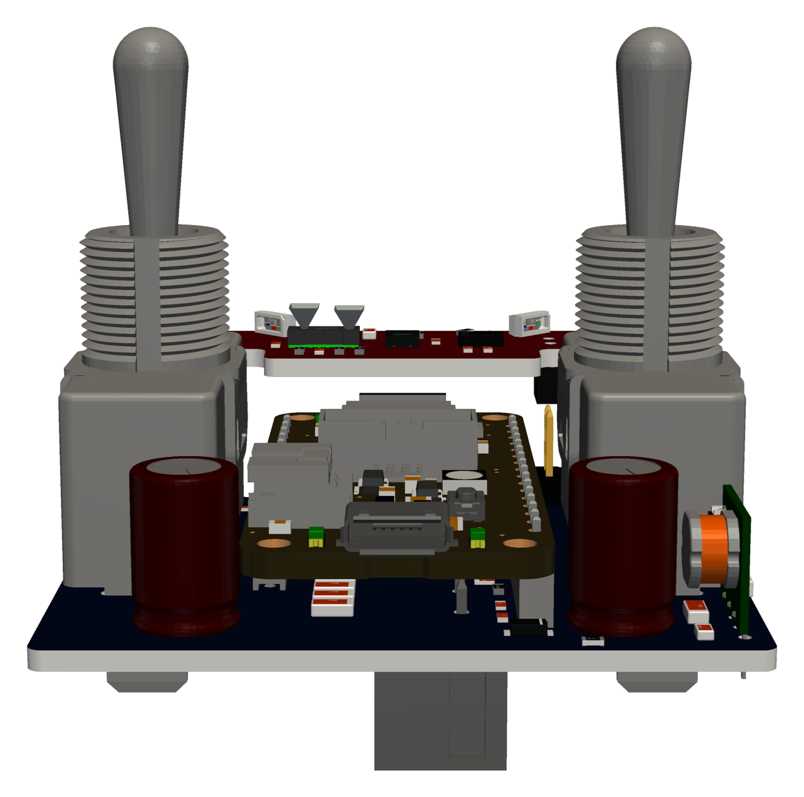

# knixx thunder

**Flip a switch, sense the room, speak KNX.**

knixx thunder is a KNX TP1 bus device built on an
[Adafruit Feather nRF52840 Express](https://www.adafruit.com/product/4062)
and the knixx Thunder and Thunder Sensor boards (schematics in `pcb/`). Its
firmware is written in Rust on [embassy](https://embassy.dev), without a
heap but for its scripts, which add logic of your own in
[Rhai](https://rhai.rs) without reflashing. It talks to the KNX bus
through an onsemi NCN5121 transceiver on UARTE0 at 38400 baud.

<p align="center">
  
  
  
</p>

## Functionality

- **Wall switches.** Two momentary dual-throw toggles, A and B.
  - A press up or down sends a DPT 1.001 on or off group value write to each
    group address the switch is bound to, up to 8.
  - The telegrams go out one at a time. Each waits for the NCN5121's
    L_Data.con, which confirms that the bus acknowledged it, for at most
    500 ms.
  - Each throw pulls its pin low. The contacts are debounced on the board
    and again in software: a press counts once the contact stayed closed for
    30 ms, and the next only after it stayed open for 30 ms.
  - Holding A on and B off together for more than 5 s does `nus on`.
    Holding A off and B on does `nus off`. The two presses that start a
    gesture switch the lights as usual.
- **Temperature and humidity.** An SHT20 on I2C1 is read every 60 s, the
  first time 5 s after boot. The readings are published as DPT 9.001 (°C)
  and DPT 9.007 (%) to their group addresses.
- **Illuminance.** The ambient light sensor of a Vishay VCNL4040 on I2C1 is
  read on the same 60 s rhythm and published as DPT 9.004 (lux), from 0 to
  6553.5 lx in steps of 0.1 lx.
  - The ALS measures continuously while powered on, drawing about 260 µA.
    To keep it low-power, it is powered on for a single measurement per
    minute and shut down again, which averages under 1 µA.
  - Its proximity sensor and interrupt are not used and stay off.
- **Occupancy.** A VL53L7CX multizone time-of-flight sensor runs its motion
  indicator in autonomous ranging mode at 4x4 zones, with a detection
  threshold on each zone.
  - The sensor pulses its INT pin for every frame in which a zone's motion
    exceeds the threshold.
  - The first motion sends DPT 1.018 *occupied*, and further motion restarts
    the timeout.
  - Once the timeout passes without motion, *not occupied* is sent.
- **Status LEDs.** Two WS2812B RGB LEDs show the device state. LED1 plays
  its modes below one after another, in the order they were triggered. LED2
  shows the BLE console, independently of LED1.

  | mode | LED1 | length | trigger |
  |---|---|---|---|
  | init | blinks yellow at 5 Hz | until the ToF's first start, at most 10 s | boot |
  | occupancy | one 50 ms green pulse, then 50 ms dark | 100 ms | each motion frame of the ToF |
  | error | 10 ms red flash every 100 ms | 0.5 s | an error the firmware reports |
  | ble | LED2: 50 ms blue pulse every 1 s | until `nus off` or the idle timeout | `nus on` |

  The errors include:
  - a sensor or the ToF sensor that fails;
  - a full tx queue, whatever queued the command: a wall switch, a console
    command, a sensor reading, a motion or a script;
  - a telegram without a positive L_Data.con;
  - a configuration that falls back to the built-in default;
  - a script that fails, is stopped or does not load.
- **Configuration.** The settings are kept in `knixx.ini` on a littlefs on
  the Feather's external QSPI flash, see [Configuration](#configuration).
  - They are edited live from the console. A change is validated, applied
    without a reboot and saved.
  - Without a usable flash or file, the firmware runs with the built-in
    default.
- **Console.** A command shell on the USB serial port, with line editing
  and a history, see [Console](#console).
- **BLE console.** `nus on` moves the console to the Nordic UART Service
  (NUS) on Bluetooth LE, see [BLE console](#ble-console).
- **Pairing.** BLE takes a paired central: one that bonded with the board
  while the console was on BLE, which takes the USB console or the wall
  switches. Up to four bonds are kept, see [Pairing](#pairing).
- **Web app.** With the `web-ble` firmware, a browser on a phone or a
  computer switches the lights of the installation and sends any group
  value, over Web Bluetooth and the board's knixx GATT service, see
  [Web app](#web-app).
- **Scripts.** Up to four scripts in Rhai, written from a template on the
  host, compiled to Rhai Grain bytecode and uploaded with `bolt script`,
  see [Scripts](#scripts). Each gets every telegram on the bus and a call
  every second, keeps its state from call to call, and sends telegrams.
- **Updates.** Over USB through the Feather's UF2 bootloader, or over BLE
  through its DFU mode, see [Flashing](#flashing).

## Requirements

The firmware and the host tools build on macOS and Linux.

- Rust through rustup; `rust-toolchain.toml` pins the version and adds the
  `thumbv7em-none-eabihf` target.
- [flip-link](https://github.com/knurling-rs/flip-link):
  `cargo install flip-link`. It is the firmware's linker; it puts the stack
  below the statics, so a stack overflow faults instead of corrupting them.
- clang and libclang. The littlefs C library is compiled with clang for the
  nRF52840, with its freestanding headers and the two in
  `firmware/c-include/`, so no C library or ARM GCC is needed; the C
  libraries' Rust bindings (littlefs, Nordic's MPSL and SoftDevice
  Controller) are generated with libclang. macOS has both with the Xcode
  command line tools; on Debian or Ubuntu: `apt install clang libclang-dev`.
- For `bolt`, on Linux: `apt install libdbus-1-dev pkg-config`, for BLE
  through BlueZ, with `bluetoothd` running. The firmware build, `cargo
  xtask build`, does without.
- On Linux, access to `/dev/ttyACM*` (the `dialout` group), for flashing
  and the console over USB. ModemManager probes new serial devices, which
  disturbs the console; a udev rule keeps it away from the board, in
  `/etc/udev/rules.d/99-knixx.rules`:

  ```
  ATTRS{idVendor}=="1209", ATTRS{idProduct}=="a7ea", ENV{ID_MM_DEVICE_IGNORE}="1"
  ```
- Optional: [cargo-deny](https://github.com/EmbarkStudios/cargo-deny), for
  `cargo deny check` (licenses: permissive ones and MPL-2.0 only, see
  [Third-party code](#third-party-code)), and
  [cargo-bloat](https://github.com/RazrFalcon/cargo-bloat).
- For `cargo xtask golden` only: a C compiler for the host, `cc` or
  `$CC`.
- For the CAD tools in `cad/` only: Python 3.11 to 3.14, see
  [Renders and front plate](#renders-and-front-plate).
- For the web app in `web/` only: [trunk](https://trunkrs.dev),
  `cargo install trunk --locked` or `brew install trunk`;
  `web/rust-toolchain.toml` adds the `wasm32-unknown-unknown` target.

```sh
cargo xtask build    # build the firmware: build/knixx.{elf,uf2,hex}, build/knixx-dfu.zip; --web-ble, --no-scripts
cargo xtask flash    # build and flash over USB; --port picks the serial port; --web-ble, --no-scripts
cargo xtask ota      # build and flash over BLE (run ota on the console first); --addr picks a board
cargo xtask term     # a terminal on the console, on USB, else BLE; --usb, --ble, --port, --addr
cargo xtask cycle N  # build, then flash N times, checking USB and BLE after each
cargo xtask golden   # record the VL53L7CX golden log with ST's C driver; --check compares
cargo xtask genfw    # extract the VL53L7CX firmware from ST's driver; --check compares
cargo xtask cad      # the renders and the front plate: render, frontplate, readme, clean
cargo xtask web      # serve the web app on localhost; --build builds it into web/dist/
cargo test           # the host tests
bolt script upload <script>  # build <script>.rhai and run it on the board; see Scripts
```

## Building

```
cargo xtask build
```

builds the firmware, stamped with the git commit (with `-dirty` when
tracked files differ from it) and the build time in UTC, and writes
`build/knixx.elf`, `build/knixx.uf2`, `build/knixx.hex` and the DFU package
`build/knixx-dfu.zip`. It reports the flash and RAM the firmware takes, and
fails when the image does not fit `0x26000`–`0xED000`, or on the heap rule
below. `cargo xtask build --no-scripts` builds the firmware without scripts:
about 456 KB of flash, against 714 KB with them, of which Rhai is some
165 KB and BLE pairing (LE Secure Connections, with its P-256 code) some
64 KB. `cargo xtask build --web-ble` adds the knixx GATT service for the
[web app](#web-app), about 6 KB more, and `--coded-phy` long-range BLE on
the coded PHY, about 22 KB more (see [Radio](#radio)); the flags combine.
With all of them the firmware takes 742 KB, 91% of the application's flash.

**A heap for scripts only.** The crates in `crates/` are `no_std` without
`alloc`, and buffers are fixed size, in statics or in the embassy tasks.
Only the scripts in Rhai Grain allocate, from a heap of 48 KiB of their own
(`firmware/knixx-fw/src/heap.rs`, the `scripts` feature, on by default): a
TLSF allocator, constant time and without a lock, that serves only in thread
mode while the script task holds its grant, and panics with `alloc outside
Rhai Grain` otherwise, allocating and freeing alike, so an allocation
anywhere else shows at once. `sys` shows the heap in use and the most used
since boot. Without the `scripts` feature the firmware links no allocator at
all, and `cargo xtask build --no-scripts` fails if it does.

**RAM.** The statics take about 55 KiB without scripts and 110 KiB with
them, the heap included (116 KiB with `--web-ble --coded-phy`, whose BLE
controller needs 7.4 KiB rather than 2.8); the stack below them has the
rest, about 200 KiB without scripts and 146 KiB with them. flip-link puts the stack at the
bottom of RAM, so that an overflow faults instead of overwriting statics. The embassy tasks live in statics; the stack
serves `main`, the executor and the interrupt handlers. `sys` shows the most
of it used since boot: the firmware paints the stack at boot and finds the
lowest word that changed.

`cd firmware && cargo bloat --release --crates` shows what takes the flash.

**Flash layout.** The firmware keeps the Feather's stock layout: the MBR
and the S140 6.1.1 SoftDevice below `0x26000` stay untouched and the
SoftDevice is never enabled, so the Adafruit UF2 bootloader keeps flashing
over USB and BLE.

| Region | Range |
|---|---|
| MBR + S140 6.1.1 | `0x00000`–`0x26000` |
| Application | `0x26000`–`0xED000` |
| User data | `0xED000`–`0xF4000` |
| UF2 bootloader | `0xF4000`– |

The application links at `0x26000` (`firmware/knixx-fw/memory.x`) with
`cortex-m-rt`'s `set-vtor`, so its vector table does not depend on the MBR's
forwarding. Its RAM starts at `0x20000008`, after the MBR's 8 bytes, with
the panic record: 256 bytes that the UF2 bootloader, whose RAM starts at
`0x20008000` with its stack at the top, leaves alone across a reset. The
stack starts after it, at `0x20000108`.

## Flashing

### From a release

Each [GitHub release](https://github.com/flukso/knixx-rs/releases) carries
the firmware, so that a board can be flashed without building it:

| file | what |
|---|---|
| `knixx.uf2` | the firmware, for the UF2 bootloader's drive (USB) |
| `knixx-dfu.zip` | the firmware as a DFU package (BLE) |
| `knixx.hex`, `knixx.elf` | the firmware for a debug probe, and with its symbols |
| `knixx-web-ble.uf2`, `knixx-web-ble-dfu.zip`, … | the firmware with the knixx GATT service for the [web app](#web-app) |
| `knixx-web-ble-coded.uf2`, `knixx-web-ble-coded-dfu.zip`, … | the same with long-range BLE on the coded PHY, see [Radio](#radio) |
| `bolt-<tag>-<target>.tar.gz` | `bolt` for Linux (x86_64, aarch64) and Apple Silicon macOS |

Double-tap reset to get the bootloader's `FTHR840BOOT` drive and copy a
`.uf2` onto it, or use `bolt uf2 knixx.uf2`. On macOS, a `bolt` downloaded
with a browser is quarantined: `xattr -d com.apple.quarantine bolt` lets it
run. A tag `v*` pushed to GitHub makes the release
(`.github/workflows/release.yml`).

### Over USB

```
cargo xtask flash [--port <serial port>]
```

builds the firmware and flashes it with `bolt uf2`:

1. It resets the running board into its UF2 bootloader with the 1200-baud
   touch: it opens the board's serial port at 1200 baud and drops DTR. A
   board already in its bootloader, after a double tap of reset, is flashed
   as it is.
2. It waits for the bootloader's `FTHR840BOOT` drive and copies the UF2
   file to it. On Linux it asks udisks to mount the drive when no
   automounter has, as the user at the machine (polkit).
3. The bootloader resets the board as soon as it has the last block, while
   the host may still write the drive's file entries, so a write error is
   expected and not trusted either way: the flash passes once the board's
   `version` command prints the build just made.

It finds the board by its USB ID: knixx's own, 1209:A7EA from
[pid.codes](https://pid.codes), or 239A:802A, the Feather's, which the
firmware before 0.5 and the Go firmware use. The board shows as "knixx
thunder" by "flukso", with its device ID as serial number. On macOS the port
is the one `/dev/cu.usbmodem*`, or `--port` when there are several. `bolt uf2 [file]`
does the same for a given UF2 file, with `--expect` for the version line.

macOS must allow the terminal to write to removable volumes (System
Settings, Privacy & Security, Files & Folders).

```
cargo xtask cycle <n>
```

builds once, then flashes `n` times; after each flash the board must report
its version over USB and advertise over BLE. Every flash ends with the
bootloader jumping to the application without a reset, the path on which
USB and the BLE controller can hang.

### Over BLE

1. Run `cargo xtask ota` on the host. It builds `build/knixx-dfu.zip` and
   runs `bolt ota`, which waits up to 60 s for a bootloader in BLE DFU
   mode.
2. Type `ota` on the USB or the BLE console. The firmware writes 0xA8 to
   GPREGRET and resets. The Adafruit bootloader then starts its BLE DFU
   mode and advertises as `AdaDFU`.
3. `bolt ota` connects and sends the package with the legacy Nordic DFU
   protocol, with a receipt every 10 packets. The bootloader validates and
   starts the new firmware.

The packets carry as much as the negotiated ATT MTU allows, 244 bytes with
the bootloader's MTU of 247, which sent a 364 KB image in about a minute
(the firmware with scripts is about 698 KB);
`bolt ota --chunk` sets another size. Phone apps that speak legacy DFU, such
as nRF Connect or Bluefruit Connect, can also send `build/knixx-dfu.zip`.

`bolt genpkg <app.hex> <package.zip>` builds a DFU package as
adafruit-nrfutil dfu genpkg does, with the init packet of the Feather's
bootloader (device type 0x0052, SoftDevice id 0x00B6); the files in the zip
are byte for byte those of the Go `bolt genpkg`.

Caveats:
- `ota` resets the board: a telegram in flight is lost and the occupancy
  state is cleared.
- The bootloader stays in DFU mode until it gets an update or a reset.
- `bolt ota` takes the first `AdaDFU` it sees. With several boards in DFU
  mode, use `--addr`. The bootloader advertises with the board's address
  plus one in the last byte.
- On macOS, `--addr` is the UUID that macOS gives the bootloader, which
  differs from the board's own UUID; `bolt ota` prints it when it connects.
  The first run asks to give the terminal app access to Bluetooth.
- The bootloader runs the radio on its RC oscillator. With BlueZ's default
  connection parameters (30-50 ms, 420 ms supervision timeout) an Intel AX200
  never establishes the link (`le-connection-abort-by-local`), and the
  bootloader stops advertising after the failed attempt, so `ota` must be run
  again. Connecting at 15-30 ms with a 2 s timeout works. Set it until the next
  reboot with

  ```sh
  cd /sys/kernel/debug/bluetooth/hci0
  echo 24 | sudo tee conn_max_interval && echo 12 | sudo tee conn_min_interval
  echo 200 | sudo tee supervision_timeout
  bluetoothctl remove <AdaDFU address>   # drop the parameters kept for it
  ```

  or for good in `/etc/bluetooth/main.conf` under `[LE]`
  (`MinConnectionInterval=12`, `MaxConnectionInterval=24`,
  `ConnectionSupervisionTimeout=200`), followed by a restart of bluetoothd.

## Console

The USB serial port carries the console: the banner on the first key, then
commands after the `>>> ` prompt. Every terminal that opens the port
(raising DTR) gets the banner on its first key, also after a tool such as
the version check of `cargo xtask flash` had the port before it.

```
cargo xtask term [--usb | --ble | --port <port> | --addr <address>]
```

runs `bolt term`, a terminal on the console: on USB when the board answers
there, else on BLE. Keys go to the board as typed, and Ctrl-] quits. The
terminal holds the port for itself: `cargo xtask flash` finds it busy until
the terminal quits.

Lines are edited with backspace, and a history of 8 lines on the up and
down arrows or Ctrl-P and Ctrl-N. A line holds at most 255 characters,
which fits `config set A.group` with 8 addresses. Output never waits for a
terminal: every write goes into a 2 KiB queue of the port, which a sender
task moves to USB or BLE. A write that does not fit is dropped whole, and
once the queue has drained a `[N bytes of output dropped]` line marks the
gap. Without the queue, a host that stops reading, as once the cable is
pulled while a terminal was open, would stall every writer, the bus with
`sniff on` among them.

| command | function |
|---|---|
| `help` | list the commands |
| `switch <A\|B> <on\|off>` | send the telegrams of a wall switch press |
| `sniff [on\|off]` | show or toggle the trace of the NCN5121 indications and the decoded telegrams on the bus |
| `stat` | report the transceiver state (U_State.ind) and system status (U_SystemStat.ind) |
| `config [dump \| init \| get <key> \| set <key> <value>]` | see [Configuration](#configuration) |
| `sensor` | the latest temperature, humidity and illuminance reading |
| `tof` | the ToF state, settings, warnings, motion count and the per zone motion of the last motion frame |
| `nus [on\|off]` | show the BLE console state, move the console to BLE NUS or back to USB |
| `ble [link \| forget all\|<address>]` | show the BLE settings and the bonded centrals, the active connection (`link`, see [Radio](#radio)), or forget bonds, see [Pairing](#pairing) |
| `script [ls] \| info <name> \| rm <name> \| put <name> <size> <crc32>` | the scripts in `/scripts` with their state; what the board knows of one; remove one; `put` receives one, as `bolt script upload` sends it, see [Scripts](#scripts) |
| `ota` | reboot into the bootloader for a BLE firmware update, see [Over BLE](#over-ble) |
| `version` | the commit and build time of the firmware, `version <commit> built <date>`, also shown in the banner |
| `sys` | the uptime, the stack high-water mark, the heap in use and at most, the scripts running and the telegrams dropped for them, the bytes queued and lost on the USB and BLE console outputs, and whether a USB terminal is open (DTR) |

A panic resets the board; its message survives the reset in RAM and the
next banner shows it as `last panic: ...`. A panic while a script ran
names the script, which the next boot leaves out, see [Scripts](#scripts).

### BLE console

`nus on` moves the console from USB to the Nordic UART Service (NUS) on
BLE. Holding A on + B off on the wall switches for more than 5 s does the
same, and A off + B on does `nus off`.

- The board advertises as `knixx`. Any NUS terminal can connect, such as
  nRF Connect or Serial Bluetooth Terminal, one central at a time.
- `cargo xtask term --ble` connects from a Linux or macOS terminal with the
  computer's own Bluetooth. `cargo xtask term` does too once the console is
  on BLE, since the USB port then stays silent, or when the board is not on
  USB. `--addr` selects a board.
  - **Linux:** it goes through BlueZ, so `bluetoothd` must run; no root is
    needed. `--addr` is the MAC address. If every piece of output shows
    twice, BlueZ is sending each notification twice from stale state it
    cached for the board; `bluetoothctl remove <address>` clears it.
  - **macOS:** the first run asks to give the terminal app access to
    Bluetooth. macOS hides MAC addresses, so `--addr` is the UUID that macOS
    gives the board.
- LED2 pulses blue once a second while the console is on BLE.
- The board asks the central for a 15 ms connection interval, which keeps
  typing responsive: each typed key costs one connection event for the
  write and one for the echo.
- The banner shows on the central's first key. Output to the console,
  including bus and sensor errors, the sniffer trace and what scripts
  print, then goes to BLE; typing on USB is dropped.
- Output goes out in notifications of 20 bytes that never split a UTF-8
  character. It is dropped while no central is subscribed, and when the link
  stays congested for 1 s.
- `nus off`, typed over BLE, waits up to 1 s for the output to reach the
  central, drops the connection, stops advertising and moves the console
  back to USB.
- The console also goes back to USB after 60 s without a connected central,
  counted from `nus on` or the last disconnect, and on reset, since BLE is
  off at boot.
- **Security:** with `ble.pair` on, the default, only a paired central gets
  the console, see [Pairing](#pairing). With it off, anyone in range can
  connect while NUS is on and use the console, including `config set` and
  the upload of scripts, which can send any group telegram.

### Pairing

The console on BLE can change the configuration and upload scripts, and
the knixx service of the [web app](#web-app) sends any group telegram. So
while `ble.pair` is on, as it is by default, the board serves both only to
a **paired** central: a phone or computer that bonded with the board, and
one bond opens both services.

**Pairing a phone or computer.** Pairing is only possible while the
console is on BLE: after `nus on` on the USB console, or after holding
A on + B off on the wall switches for 5 s. Both take someone at the board.
That is the *pairing window*; it closes with `nus off`, or after 60 s
without a connection.

1. Turn the console to BLE with `nus on` (or the switch gesture). It says
   `nus: pairing open`.
2. Connect from the phone or computer: `bolt term --ble`, the web app, or
   any BLE terminal.
3. The phone or computer asks to pair: accept. The board takes LE Secure
   Connections pairing ("Just Works": there is no code to compare, as the
   board has no display), stores the bond and prints `ble: bonded with
   <address>`.

From then on the phone or computer gets in without asking, with the
console on BLE or not, until either side forgets the bond.

- **macOS:** the system shows the pairing request the first time; bolt and
  Chrome on the same Mac share the bond.
- **Linux:** bolt cannot pair by itself, BlueZ needs an agent. Pair once
  with `bluetoothctl pair <address>` while the pairing window is open. bolt
  tells you so when the board refuses it.
- **Android and Windows:** Chrome's pairing goes through the system, which
  asks the first time.

**Outside the window.** A central that is not bonded is refused: its
requests get "insufficient encryption", and a pairing it starts gives no
bond and drops the link. The USB console always works, so a lost phone is
never a lockout.

**Bonds.** The board keeps up to 4, in `/ble/bonds` on the flash; a fifth
replaces the oldest.

```text
ble                     the pairing setting, the knixx service and the bonds
ble forget <address>    forget one bond, by the address ble lists
ble forget all          forget every bond
```

After `ble forget`, the phone or computer still holds its half of the bond
and fails to connect ("Device disconnected"): remove `knixx` in its
Bluetooth settings too (`bluetoothctl remove <address>` on Linux), then
pair again in a pairing window.

**Firmware updates.** Phones and computers cache the services of a bonded
board. When an update changes them, for example to or from the `web-ble`
firmware, the board tells each bonded central on its next connection (the
GATT Service Changed indication), and the central reads them again. A
central that bonded with firmware older than this has no Service Changed
in its cache and needs pairing once more. The last line of `ble` shows
what the last bonded connection did about it.

**Without pairing.** `config set ble.pair off` turns the check off at once
and saves it: anyone in range then gets the console and the knixx service
while the board advertises. The bonds stay, so turning it on again needs no
new pairing; a connected central that is not paired is dropped then.

**OTA.** `ota` starts the Adafruit bootloader's DFU mode, which has no
pairing; reaching it takes the console, so a paired central or USB.

### Radio

**TX power.** `ble.tx_power` sets the radio's transmit power, from -40 to
+8 dBm, for advertising and connections alike; 0 dBm by default. `config
set ble.tx_power 8` applies at once, without a reconnect: 8 dBm reach about
2.5 times as far as 0 dBm in free space, for more current in each radio
event, and -20 dBm keeps the board to the room it is in.

**PHYs and packets.** Every build takes the PHY a central asks for, 1M or
2M, and link-layer packets of up to 251 bytes instead of 27, which the
board asks for on connecting: a Mac then runs at 2M with 251-byte packets.
Uploads over BLE go faster.

**Coded PHY: long range.** The LE Coded PHY sends each bit as 8 symbols
(S8, 125 kbps): about 4 times the range of 1M at the same TX power, at an
eighth of its speed. It takes the `coded-phy` firmware (`cargo xtask build
--coded-phy`, which combines with `--web-ble`) and `config set ble.coded
on`. The board then advertises twice:

- on 1M as ever, so that every phone and computer finds it, and
- on coded, for a central that scans the coded PHY.

A central that connects on the coded set gets a coded link; `ble link`
shows it. Android phones with Bluetooth 5 do coded (nRF Connect scans and
connects on it); iPhones, Macs and Chrome's Web Bluetooth do not, and keep
using 1M. A connection on 1M can also move to coded when the central asks.

**`ble link`** shows the active connection, as the board sees it:

```text
central    a0:9a:8e:94:d5:3f (bonded, encrypted)
connected  2m14s
interval   15 ms, latency 0, supervision timeout 4 s
phy        tx 2M, rx 2M
data       tx 251 B / 2120 µs, rx 251 B / 2120 µs
att mtu    247
tx power   0 dBm
rssi       -46 dBm
```

The interval is the one the central settled on (the board asks for 15 ms),
`data` the largest link-layer packets and their air times both ways, and
`rssi` the strength of the central's signal as the board receives it, read
every 2 s; the central's own view of the board's signal follows
`ble.tx_power`. Without a connection it says `ble link: no central
connected`.

## Configuration

The configuration is `/knixx.ini` on a littlefs on the Feather's 2 MiB QSPI
flash (GD25Q16C). The built-in default (`crates/knixx-device/default.ini`):

```ini
[device]
individual = 7.8.1

[A]
group = 0/0/1

[B]
group = 0/0/2

[temperature]
group = 2/0/1

[humidity]
group = 3/0/1

[illuminance]
group = 4/0/1

[occupancy]
group = 5/0/1
timeout = 60
threshold = 44
frequency = 1
integration = 5
min_distance = 400
max_distance = 1500

[ble]
pair = on
knixx = off
tx_power = 0
coded = off
```

This file is written when the flash holds no `knixx.ini`, and `config init`
restores it. A file can leave out the optional keys. A missing key gets the
value in the *missing* column below, which for the group addresses is
*unbound*, not the `default.ini` value.

| key | value | `default.ini` | missing | limits |
|---|---|---|---|---|
| `device.individual` | individual address | 7.8.1 | required | area 0–15, line 0–15, device 0–255; not 0.0.0 |
| `A.group`, `B.group` | comma separated group addresses | 0/0/1, 0/0/2 | required | 1 to 8 addresses, no duplicates |
| `temperature.group` | group address or `-` | 2/0/1 | unbound | |
| `humidity.group` | group address or `-` | 3/0/1 | unbound | |
| `illuminance.group` | group address or `-` | 4/0/1 | unbound | |
| `occupancy.group` | group address or `-` | 5/0/1 | unbound | |
| `occupancy.timeout` | s without motion until not occupied | 60 | 60 | 1–65535 |
| `occupancy.threshold` | motion intensity per zone | 44 | 44 | 1–32767 |
| `occupancy.frequency` | ranging frequency, Hz | 1 | 1 | 1–60 |
| `occupancy.integration` | integration time per frame, ms | 5 | 5 | 2–1000 |
| `occupancy.min_distance` | near end of the motion window, mm | 400 | 400 | 400–4000 |
| `occupancy.max_distance` | far end of the motion window, mm | 1500 | 1500 | 400–4000 |
| `ble.pair` | whether BLE takes a paired central, see [Pairing](#pairing) | on | on | `on`, `off` |
| `ble.knixx` | whether the board advertises the knixx service for the [web app](#web-app) all the time | off | off | `on`, `off`; `on` only with the `web-ble` firmware |
| `ble.tx_power` | the radio's transmit power, dBm, see [Radio](#radio) | 0 | 0 | -40, -20, -16, -12, -8, -4, 0, 2 to 8 |
| `ble.coded` | whether the board also advertises on the coded PHY, for long range, see [Radio](#radio) | off | off | `on`, `off`; `on` only with the `coded-phy` firmware |

Group addresses use the 3-level form 0–31/0–7/0–255. The 2-level form
(main/sub) and raw numbers are also accepted. 0/0/0, the broadcast address,
is rejected. `-` unbinds an optional group: nothing is sent for it.

### Console

```text
config                      list all keys with their values
config get <key>            print one value
config set <key> <value>    validate, apply and save one value
config dump                 print the configuration as config set commands
config init                 restore and save the built-in default
```

- **Key names** are case-insensitive. A group list may be typed with spaces
  after the commas.
- **Failed changes:** an invalid value leaves the configuration unchanged and
  prints the reason.
- **`config dump`:** replaying its output line by line on another device
  reproduces the configuration, and the same `knixx.ini`.
- **Unknown content:** unknown sections and keys in `knixx.ini` are ignored.
  This includes the `[sensor]` section of earlier versions, whose
  temperature and humidity groups are now `temperature.group` and
  `humidity.group`.
- **Size:** `knixx.ini` must stay under 1024 bytes.

### Dependencies and caveats

- **Occupancy needs `occupancy.group`.** While the group is unbound, motion is
  ignored and no occupancy telegram is sent. The ToF sensor still runs.
- **Frequency and integration time.** The integration time plus 1 ms of
  overhead must be shorter than the ranging period, 1000 / frequency ms; for
  example, 15 ms at most at 60 Hz. Otherwise the sensor stretches the period
  to fit and ranges below the configured frequency. The configuration
  accepts such a combination, so that the keys can be set in any order, and
  `tof` warns about it.
- **Motion window.** The sensor needs `min_distance` < `max_distance`, and
  `max_distance` − `min_distance` ≤ 1500 mm.
  - Each key is checked only against 400–4000. An invalid pair is accepted,
    so that the window can be moved one key at a time.
  - The ToF keeps running with the last valid window (400–1500 after boot),
    and `tof` warns until the pair is valid again.
  - The window selects the distances whose changes the motion indicator
    compares. It does not hard-cut the field of view.
- **Threshold.** Motion values depend on the integration time, the distance
  and the reflectance of what moves. ST quotes 100–500 for typical movement.
  After changing `integration` or the window, use the per zone values shown
  by `tof` to retune `threshold`.
- **Illuminance range.** The ALS runs at a fixed integration time of 80 ms.
  Readings clip at 6553.5 lx, for example in direct sunlight, and `sensor`
  then marks them as saturated. The sensor's tolerance is ±10 %, and there is
  no correction for a cover lens or window over it.
- **Timeout.** The timeout restarts on every motion frame. A value shorter
  than the ranging period lets occupancy drop between frames during
  continuous motion.
- **LED standby current.** A WS2812B draws roughly 0.5–1 mA even when dark,
  so the two LEDs dominate the board's idle current.
- **Occupancy pulses.** The ToF interrupt is looked at every 50 ms, so all
  pulses within one look give a single LED pulse. Each pulse takes 100 ms, so
  fast motion frames fill the LED queue and the excess pulses are dropped.

## Scripts

Scripts add logic of your own to the board without reflashing it: up to
four scripts in [Rhai](https://rhai.rs), which the host compiles to the
bytecode of Rhai Grain, Rhai's bytecode VM, and the board runs on every
telegram on the bus and every second. A script keeps its state from call to
call and sends telegrams; the template's example follows the occupancy on
5/0/1 with light B on 0/0/2 and switches B off 10 s after the last
occupied.

```
bolt script new <script>                       # <script>.rhai, from the template
bolt script build <script>                     # <script>.rhgn: checks that it compiles
bolt script upload <script>                    # builds it, uploads it, the board runs it
bolt script ls                                 # the scripts on the board, with their state
bolt script info <script> [--source <script>]  # its on_info, calls, failures, last error
bolt script rm <script>                        # stops and removes it
```

As `bolt term`, the script commands take USB if the board answers there,
else BLE (`nus on` first); `--port`, `--ble`, `--ble-name` and `--addr` say
which. A script is named after its file, 1 to 24 letters, digits, `-` and
`_`; without an extension, `<script>` is `<script>.rhai`, else
`<script>.rhgn`.

### Writing a script

A script defines four functions; `crates/knixx-script/template.rhai`, which
`bolt script new` copies, documents them with an example.

| function | called |
|---|---|
| `on_info()` | at load: returns `#{ name, author, date, compiled, version, hash }` |
| `on_init()` | at load, after on_info: sets up the state |
| `on_telegram(tg)` | for every telegram on the bus, the board's own too |
| `on_time(uptime)` | every second, with the uptime in seconds |

on_init, on_telegram and on_time are methods of the script's state, an
object map that persists from call to call: they reach it as `this`, and
what they set in it stays, settings included, as functions see only their
parameters and `this`. A function of the script's own that uses the state
is called as `this.f()` and reaches it as `this` too. `tg` is a map: `src` and `dest` (addresses as numbers),
`group`, `apci` (`"write"`, `"read"`, `"response"` or `"other"`),
`priority`, `hops`, `data` (a blob, from the APCI octet on) and `own`, true
for a telegram this board sent, such as its occupancy.

| function | does |
|---|---|
| `ga("1/2/3")`, `ia("1.1.5")` | a group or individual address as a number |
| `ga_str(g)`, `ia_str(a)` | the number as text |
| `knx_write(g, data)`, `knx_response(g, data)` | sends a group value write or response; returns whether it was queued |
| `knx_read(g)` | sends a group value read; the answer comes later, as a response telegram |
| `dpt1(on)`, `dpt9(21.5)` | a value as telegram data |
| `dpt1_of(data)`, `dpt9_of(data)` | the value of telegram data |
| `blob([0, 128])` | telegram data of bytes, from the APCI octet on |
| `data.len()`, `data[i]` | the length and the bytes of a blob |
| `print(text)`, `debug(value)` | a line on the console, as `<script>: text` |

`bolt script build` fills in `compiled` (the UTC time), `version` (the
short commit hash of the script's git repository, `-dirty` when the file
differs from it, `unversioned` outside one) and `hash` (the md5 of the
source) for the placeholders `{{compiled}}`, `{{version}}` and `{{hash}}`,
and checks that the script defines the four functions with their
parameters, compiles to bytecode all through, and returns what it filled in
from on_info.

The board runs Rhai's bare engine with what scripts need, not Rhai's
packages, so some of Rhai is not there: `for` loops (use `while` and
`loop`; the compiler refuses `for`), modules, and constants at the top of a
script, which functions cannot see, and closures. Integers are 32-bit,
floats 32-bit.

### Limits

| limit | |
|---|---|
| operations per call | 1,200, about 20 ms on the board; more is an error |
| nested calls | 8 |
| strings, arrays, maps | 256 characters, 64 elements, 32 entries, counted over a value and what it holds, the state too |
| telegrams sent | 4 per call and 16 per second per script; more return false |
| script size | 16 KiB of bytecode |
| scripts | 4 at a time |

### On the board

The script task loads `/scripts/*.rhgn` at boot and runs each with its
on_info and on_init; an upload loads the script anew at once, and
`script rm` stops it. Each call runs on a VM of its own, holding the heap's
grant: the 48 KiB heap is the scripts' alone.

- **Failures.** A failed call is reported on the console, as
  `script <name>: on_telegram: <error>`, and blinks red. Five failures in a
  row of one function stop the script until it is uploaded again or the
  board resets. `script info` shows the last error with the addresses of
  its instructions; `bolt script info <name> --source <file>` rebuilds the
  source as the board's was built and shows their lines.
- **Heap.** A script whose call leaves more than 30 KiB of the heap in use
  is stopped, freeing what it holds; one whose bytecode does not fit the
  heap free is not loaded.
- **Panics.** A panic while a script runs, which the limits make unlikely,
  names the script in the panic record: the next boot leaves it out and the
  banner says so.
- **Status.** `script ls` shows each script's state: running, failed,
  stopped, left out or not loaded; `script info` adds its on_info, its
  calls, failures and longest call. `sys` counts the scripts running and
  the telegrams dropped when the scripts fell behind.

`bolt script upload` sends a script with `script put <name> <size>
<crc32>`. The console then takes the bytes raw, without editor, echo or
history, answers `ok <offset>` after each 128 bytes, so that BLE, without
back-pressure, never overruns it, checks the CRC-32 at the end and writes
`/scripts/<name>.rhgn` whole, through a temporary file (`done <size>`), or
answers `error: ...` after a bad CRC or 5 s without a byte.

Rhai Grain, Rhai's bytecode VM, came with Rhai 1.27 and is experimental.
The board reads only bytecode written for its build of Rhai, the integer
and float widths and the language features: build scripts with the `bolt`
of the same repository.

## Web app

The web app, in `web/`, switches the lights of the installation from a
browser and sends any group value, through the board and over Bluetooth
LE. It runs in Chrome or Edge, on a desktop or on Android: they have Web
Bluetooth. Safari, iOS and Firefox do not.

It is served at **https://flukso.github.io/knixx-rs/**, from
`.github/workflows/pages.yml` on every push to `main` that changes it, and
`cargo xtask web` serves it on localhost while working on it.

Chrome can **install** it, as an app of its own with an icon (the bulb of
`web/icons/`, drawn in `icon.svg` and `maskable.svg`): *Install app* in
Chrome's menu, or the install button in the address bar on a computer.
`web/manifest.webmanifest` describes the app, and the service worker in
`web/sw.js` keeps its files, so that it also starts without a network: it
reaches the board over Bluetooth only. Online, every start fetches the
current app. Installing needs HTTPS, which GitHub Pages gives, or
localhost.

### Setting up the board

1. Flash the firmware with the knixx GATT service: `cargo xtask flash
   --web-ble`, or `knixx-web-ble.uf2` from a [release](#from-a-release).
   The default firmware leaves the service out, and `config set ble.knixx
   on` says so.
2. `config set ble.knixx on`. The board then advertises all the time, not
   only while the console is on BLE, so that the app finds it.
3. Pair the phone or computer once, see [Pairing](#pairing): `nus on`, open
   the app, **Connect**, and accept the pairing request. From then on the
   app connects without the pairing window.

### Using it

- **Connect** opens the browser's list of boards: it lists the boards that
  advertise the knixx service. One phone or computer is connected at a
  time; while the app is, `bolt term --ble` waits.
- **Lights.** The main view is a grid of 24 lights. Each light has two
  group addresses: its **switch** address, which a tap on the tile writes
  (DPT 1.001, on or off), and its **status** address, on which its actuator
  reports the light's state. By default light *n* is switched on 0/0/*n*
  and reports on 0/1/*n*.
  - On connecting, the app reads each status address, one at a time: the
    next once the board reported the previous one sent, so that the bus and
    the board's queue are not flooded. 24 lights take a second or two.
  - A tile shows *on* or *off* from the answers, *?* until its light
    answers, and *no answer* when none came within 2 s.
  - From then on, every write or response on a status address, by a wall
    switch, another device or the app, keeps its tile up to date. A tap
    writes the opposite of what the tile shows to the switch address; the
    tile changes once the actuator reports the new state.
  - A status address answers a read only when its actuator's status object
    has the read flag (R) set. An installation with another numbering
    sets the first switch address, the first status address and the
    number of lights under **Lights**, which the browser remembers.
- **Send a group value** writes or reads any group address, as DPT 1.001
  (on/off), 5.001 (0–100 %) or 9.001 (a 2-byte float, such as a
  temperature).
- **Bus** logs every group telegram on the bus, the board's own too
  (*this board*), with its value guessed from its length, and the outcome
  of the app's sends: *confirmed* by the bus, *negative confirmation*, *no
  confirmation* (is the bus there?), *refused* or *busy*.
- **Signal**, at the top right: the strength of the link as the board
  receives it, in dBm, with bars, every 2 s. Below about -85 dBm the link
  gets unreliable.
- **Theme**, the button at the top right: ◐ follows the light or dark mode
  of the system, ☀ keeps the app light and ☾ dark. The browser remembers
  the choice.

The app sends from the board's individual address, as a script does: the
board sends group value writes, reads and responses only, with the same
checks as for scripts.

### The knixx GATT service

The app is one client of the service; any BLE central that pairs can use
it. The service is `6b6e7801-1b5d-4c8e-a2f0-3e5b9d8c7a10`; its
characteristics differ in the first group. Every value fits the 20 bytes of
a notification at the default ATT MTU, and `crates/knixx-knx/src/gatt.rs`
encodes and decodes them for the board and the app alike.

| characteristic | properties | value |
|---|---|---|
| `…7802…` send | write | seq, op (0 write, 1 read, 2 response), group (2 bytes, big endian), priority (0 system … 3 low), data from the APCI octet on, as for DPT 1.001 `01`; a read takes no data |
| `…7803…` result | notify | seq, status: 0 confirmed, 1 negative confirmation, 2 no confirmation, 3 refused, 4 busy (send again later), 5 failed |
| `…7804…` group | notify | flags (bit 7: the board's own; bits 4–5: op; bits 0–1: priority), source and destination (2 bytes each, big endian), data |
| `…7805…` rssi | read, notify | the link's RSSI as the board receives it, dBm, signed, every 2 s |

The board takes a send into the same queue as the console's commands and
reports its result once the bus confirmed it, or after 500 ms without a
confirmation. A full queue gives *busy* at once.

## Hardware connections

| function | Feather pin | nRF52840 |
|---|---|---|
| NCN5121 | TX / RX | UARTE0: P0.25 / P0.24 |
| SHT20 (0x40), VL53L7CX (0x29) and VCNL4040 (0x60) | SDA / SCL | TWIM1: P0.12 / P0.11 |
| VCNL4040 INT (PROX.INT), unused | A2 | P0.30 |
| WS2812B data in, LED1 then LED2 | A3 | P0.28 (PWM0) |
| VL53L7CX INT, open drain | SCK | P0.14 |
| VL53L7CX LPn | MOSI | P0.13 |
| VL53L7CX I2C_RST | MISO | P0.15 |
| wall switch A on / A off, active low, internal pull-up | D9 / D10 | P0.26 / P0.27 |
| wall switch B on / B off, active low, internal pull-up | A0 / A1 | P0.04 / P0.05 |
| QSPI flash, in single-line SPI mode | on board | QSPI: SCK P0.19, CSN P0.20, IO0 P0.17, IO1 P0.22; WP# P0.23, HOLD# P0.21 |

The schematics of the knixx Thunder and Thunder Sensor boards are in
`pcb/`.

## How it works

The firmware is one embassy executor on the nRF52840, with tasks for the
USB device and its sender, the console, the BLE controller and host, the
bus, the sensors, the ToF sensor, the wall switches, the scripts and the
LEDs. The console, the switches, the sensors, the ToF and the knixx GATT
service queue commands for the bus on one channel of 16, the scripts their
telegrams on one of 4, which the bus serves only when the other is empty.
The bus passes every telegram it receives to the script task on a channel
of 16, and the group value telegrams and the outcome of its sends to the
knixx service on channels of 8. The errors and the motions trigger the LEDs
through a channel of 8. Senders never wait on a full channel.

```
 console (USB CDC or BLE NUS) ─────┐
 sensor (SHT20, VCNL4040, 60 s) ───┤
 tof    (VL53L7CX INT pulses) ─────┤
 switches (wall switch presses) ───┼─► CMDS (16) ────────► bus ─► NCN5121 ─► KNX TP1
 knixx GATT (send, web-ble) ───────┘                     ▲ │ ▲   UARTE0
        ▲                                                │ │ └─ L_Data.con, indications
        └──────── GROUP (8), RESULTS (8) ◄───────────────│─┤
 runner (scripts, 1 s) ───────────► SCRIPT_CMDS (4) ─────┘ │
        ▲                                                  │
        └──────────────────── TELEGRAMS (16) ◄─────────────┘

 main (init), tof (start, motion), errors ─► leds (8) ─► WS2812B ×2
```

### Bluetooth

The firmware runs Nordic's SoftDevice Controller
([nrf-sdc](https://github.com/alexmoon/nrf-sdc)), linked into the
application, under the [trouble](https://github.com/embassy-rs/trouble) BLE
host. The S140 SoftDevice in flash is never enabled; the bootloader still
uses it for BLE firmware updates. The multiprotocol service layer (MPSL)
runs from boot and owns the clocks, so USB gets its crystal clock through
it. It keeps interrupt priorities P0 and P1 to itself: the application's
interrupts run at P2 and P3, which the firmware checks at boot. Before
anything else, `main` clears the POWER and CLOCK state that the bootloader
leaves when it jumps to the application (nrf-sdc issue #103). The
controller is set up at boot and stays idle, with the radio silent, until
`nus on`, or for good with `ble.knixx` on.

- **One central at a time**, with NUS and, in the `web-ble` firmware, the
  knixx service. With the knixx service, the advertising carries its UUID,
  for the app's filter, and the scan response the NUS UUID: two 128-bit
  UUIDs and the name do not fit one packet. `nus off` drops the central
  unless the knixx service keeps the board advertising and the central is
  bonded.
- **The radio.** The controller supports 2M, the PHY update a central asks
  for and data length extension; the board asks for 251-byte packets on
  connecting. Its default TX power comes from `ble.tx_power` at boot, and
  a change goes to the advertising and the connection with Nordic's vendor
  command, on the fly. A task reads the link's RSSI and TX power every 2 s
  for `ble link` (and for the knixx service's `rssi`).
- **Coded PHY** (`coded-phy`) needs the controller's multirole library,
  which has extended advertising and the coded PHY. The controller holds to
  legacy or extended advertising commands from the first it gets, so this
  build advertises its 1M set (a legacy PDU) through the extended commands
  too, next to the coded set. The controller keeps a peripheral link for
  each connectable set it advertises, so it has two; the board serves one
  central and stops the other set once one connects.
- **Pairing** is trouble's LE Secure Connections, with the P-256 code for
  the Cortex-M4. The check of `ble.pair` is made at run time rather than
  with the GATT table's permissions, so that it can change without a
  reboot: the BLE task refuses the requests on NUS and the knixx service of
  a central that is not let in with "insufficient encryption", and asks
  for security on connecting. Only a connection made in the pairing window
  is bondable; a pairing outside it gives no bond, and the link is dropped.
  The host keeps the bonds, `/ble/bonds` keeps them across resets.
- **Service Changed.** trouble's GATT service has no Service Changed, so the
  BLE task builds the GAP and GATT services itself, with it. Each bond keeps
  the hash of the GATT database its central last saw; a bonded central
  with another hash gets the indication once its link is encrypted. The
  board does not store the centrals' subscriptions, so it subscribes the
  central to Service Changed itself first, as the bond would have kept it.

### KNX bus

The bus task runs `crates/knixx-bus`, a sans-IO engine with an async runner
over the UART: it is the only user of the transceiver and works on its own
copy of the configuration.

- It takes one command at a time. A command expands into group writes, sent
  one by one, each after the previous L_Data.con or its 500 ms timeout.
  Further commands wait until the writes are done. A script's telegram, a
  group value write, read or response, goes the same way, from the board's
  own address; the scripts' commands wait while the others have one. So
  does a send of the knixx service. The engine reports the outcome of
  these sends: confirmed, a negative L_Data.con, none in time, refused, or
  not handed to the transceiver; the knixx service passes it on.
- It passes every valid telegram it receives to the scripts, the board's
  own too, which the transceiver returns, marked as such.
- It wakes on received bytes, on a command and on its next deadline (the
  L_Data.con, the stat replies, the occupancy timeout), not on a poll.
- With `sniff on` it decodes each frame from the bus, including the echo of
  the frames it sends. It prints the source, destination, service, data,
  priority and routing counter. For a group this device binds, it also
  prints what the group is bound to, its DPT and the value, for example
  `L_Data.ind: 1.1.5 > 0/0/1 GroupValueWrite $01 (A, DPT 1.001: On), low
  priority, routing 6`.
- A group that is not bound gets the DPT of the bindings on its main and
  middle group, when they agree, for example `(DPT 9.001: 21.50 °C)` for
  2/0/7 with the default configuration. When a value does not unpack with
  that DPT, only the raw data is printed.
- Received bytes land in a 1 KiB ring by EasyDMA, about 267 ms of a busy
  bus, so none are lost while the flash erases or a script runs.

### Sensors

The SHT20 and the ambient light sensor of the VCNL4040 are read 5 s after
boot and then every minute, on an absolute ticker. A sensor that fails is
reported, blinks red and is tried again the next minute. They share I2C1
with the VL53L7CX, one transaction at a time. The internal pull-ups are on,
so that a missing sensor board fails with a NACK instead of leaving the
lines floating.

### Occupancy

The ToF task resets the sensor's I2C interface, boots the sensor, which
includes the firmware upload of about 2 s, programs the settings and starts
ranging; after this first start, whether it succeeds or fails, it cancels
the init blink. Every 50 ms it turns the INT pulses counted since into a
motion for the bus engine, which publishes occupancy, and a green pulse. A
change of the settings applies without a reboot, by stopping, reprogramming
and restarting ranging; a sensor that fails is tried again a minute later.

`crates/knixx-vl53l7cx` ports the parts of ST's VL53L7CX ULD 2.0.1 driver
that this needs, with the motion indicator and detection thresholds plugins
and the sensor firmware (86 KiB). ST's C driver is vendored in the crate,
in `VL53L7CX_ULD_driver_2.0.1/`, as the reference for the port:
`testdata/harness` runs it on the host against a fake sensor and logs its
I2C transactions and waits, and the crate's golden test checks that the
Rust port performs the same transactions, byte for byte. `cargo xtask
golden` builds the harness with the host's C compiler and records the log
in `testdata/configure.golden`; `--check` only compares it. `cargo xtask
genfw` extracts the sensor firmware and default settings from the ULD's
`vl53l7cx_buffers.h` into `firmware/`, which the crate embeds; `--check`
only compares them.

### Storage

`crates/knixx-storage` drives the littlefs C library with 256-byte pages,
4 KiB blocks, 512-byte caches and on-disk version 2.1, the filesystem the Go
firmware made. The littlefs2 crate is not used: it pins on-disk version 2.0,
and littlefs does not mount a filesystem of a later minor version.

Besides `/knixx.ini`, the littlefs holds other files, such as the scripts
in `/scripts` and the BLE bonds in `/ble/bonds`: the crate reads, writes, removes and lists whole files by
path, and makes directories. A write goes to `<path>.tmp` first and is then
renamed, so that a reset halfway leaves the old file, not part of the new
one. None of these formats the flash: only the boot does, and only a blank
one.

At boot the firmware mounts the littlefs, writes the default configuration
when there is no file, and shows what it did under the banner. A blank flash
is formatted, but a flash that holds a littlefs that does not mount is left
alone: the firmware falls back to the built-in default and blinks red.
`config set` and `config init` save the file. The flash is driven in
single-line SPI mode through an aligned RAM buffer, since QSPI's EasyDMA
only reaches RAM.

### LEDs and switches

The two WS2812B status LEDs run from PWM0 and EasyDMA, not bit-banging,
which the BLE controller's timing does not allow. The LED task owns them:
the modes are queued, up to 8, and play in order; a cancel ends the playing
mode of its kind and drops the queued ones; the strip is written only when a
LED changes.

Each wall switch contact has a task that waits for its edges, debounces
them and counts the presses. Every 20 ms the switch task turns a changed
count into the `switch` command's telegrams, and watches the contacts for
the hold gestures. A gesture fires once after 5 s and re-arms on release; it
only posts a request, which the console task carries out with the code of
the `nus` command, as it alone moves the console.

## Host tools

- `bolt`: `bolt uf2` and `bolt ota` flash the firmware over USB and BLE,
  `bolt genpkg` builds DFU packages, `bolt term` is the terminal on the
  console, `bolt script` makes, builds and uploads scripts and lists and
  removes the ones on the board, `bolt scan` looks for a board's
  advertising, and `bolt convert`
  turns the firmware ELF into UF2, Intel HEX or a binary. `cargo xtask`
  runs it; `cargo build --release -p bolt` builds it alone, as
  `target/release/bolt`.
- `web/` is the [web app](#web-app), in Rust with
  [Leptos](https://leptos.dev), built to wasm with trunk. It is a workspace
  of its own, like `firmware/`, and uses `crates/knixx-knx` for the knixx
  service's values, the group addresses and the DPTs. `web/src/ble.rs`
  holds the Web Bluetooth calls (web-sys keeps them behind
  `--cfg=web_sys_unstable_apis`, which `web/.cargo/config.toml` sets);
  `web/src/app.rs` the page.

  ```
  cargo xtask web            # serve it on http://127.0.0.1:8080, rebuilt on changes
  cargo xtask web --build    # build it into web/dist/
  ```

  `localhost` counts as a secure context, so Web Bluetooth works there
  without HTTPS.
- `knixx-shell` runs the bus engine and the shared console commands
  (`switch`, `sniff`, `stat`, `config`) on the host, over an NCN5121
  attached through an FTDI USB serial adapter (0403:6001). It uses the ini
  file given by `--config`, `knixx.ini` by default, or the built-in default
  when that file does not exist yet; `config set` and `config init` then
  create it.

  ```
  cargo run -p knixx-shell -- [--port <serial port>] [--config knixx.ini]
  ```

## Renders and front plate

```
cargo xtask cad <render|frontplate|readme|clean> [--step <model.step>]
```

runs the Python tools in `cad/`, which write their outputs to `build/cad/`,
named after the 3D model of the assembled boards, `pcb/Knixx_Thunder_00.step`
unless `--step` names another. The model is not in the repository, and
`.gitignore` keeps any `pcb/*.step` out of it. The tools run in a venv,
`cad/.venv`, which the first run makes with the newest Python from 3.14 down
to 3.11 on the `PATH` (or `$PY`) and fills with `cad/requirements.txt`
(OpenCascade, PyVista); it is made again when the requirements change.
`cargo xtask cad clean` removes it.

- `cargo xtask cad render` renders the model from five angles, with a
  transparent background: `<model>_{iso_front,iso_back,top,bottom,side}.png`.
  It needs the model.
- `cargo xtask cad readme` renders, makes the front plate and copies the
  PNGs that this README shows to `docs/img/`, which is tracked.

`cargo xtask cad frontplate` makes the front plate. The plate needs no model:
its dimensions, below, are constants at the top of `cad/frontplate.py`. With
the model present, the plate is first checked against it: the switch axes
must be 40 mm apart, like the holes, and the VL53L7CX must sit
`SLOT_OFFSET` (17.955 mm) above the line through them, like the window; a
mismatch stops it before it writes anything. It makes:

- `<model>_frontplate.step`: the plate, without engraving, with its
  lower-left corner at the origin and its underside at z = 0.
- `<model>_frontplate.dxf`: its outline for cutting.
- `<model>_frontplate_<curve>.dxf`: the outline with a curve engraved, one
  for each of the 14 curves below.
- `<model>_sampler.dxf`: nine of the curves in a 3 × 3 grid, on a plain
  80 × 80 mm square without the holes and the window. By row from the top
  left: Cassini oval, trefoil, teardrop; nephroid, Lissajous, limaçon;
  deltoid, hypotrochoid, bicorn. Each is centred in its 26.7 mm cell, at
  the same 11 mm radius as on the plates.
- `<model>_sampler.png`: the sampler in grey on a transparent background,
  shown below.
- `<model>_assembly.step`, only with the model: the boards with the plate.
  `cargo xtask cad render --step build/cad/Knixx_Thunder_00_assembly.step`
  renders it. OpenCascade writes its colour styles in a different order on
  each run, so the assembly is not byte for byte the same from one run to
  the next.

The DXFs are R12 in mm, with the plate's lower-left corner at the origin:
lines, circles and arcs for the outline on layer 0, and the curve on layer
`ENGRAVE`.

- **Plate:** 1.5 mm aluminium, 80 × 80 mm. Ø12.2 mm holes for the toggle switch
  bushings, 20 mm left and right of the centre.
- **Window:** a 23.2 × 3.2 mm slot with rounded ends, centred in X and
  17.955 mm above the switch axes, on the VL53L7CX.
- **Engraving:** each curve is one closed polyline of 3600 points, so it
  engraves as a single toolpath. It is centred in X, a quarter of the plate
  up from the bottom edge, and scaled to 11 mm at its largest radius. A
  curve with a centre of symmetry is centred on it, any other on the middle
  of its bounding box.
- **Height:** the plate's underside sits 3 mm above the switch bodies.
- **Sensor board:** in the assembly, its underside is moved to 12 mm above
  the main board.

<p align="center">
  
</p>

The curves, as `<curve>` names them in the file names:

| `<curve>` | Curve | z(t) or r(θ) |
|---|---|---|
| `hypotrochoid` | Hypotrochoid, R = 5, r = 3, d = 5 | 2e^(it) + 5e^(−2it/3), t over 6π |
| `lemniscate` | Lemniscate of Bernoulli | (cos t + i sin t cos t) / (1 + sin² t) |
| `lissajous` | Lissajous 1:2, phase π/4 | sin t + i sin(2t + π/4) |
| `cardioid` | Cardioid | r = 1 − cos θ |
| `astroid` | Astroid | cos³ t + i sin³ t |
| `nephroid` | Nephroid | 3e^(it) − e^(3it) |
| `deltoid` | Deltoid | 2e^(it) + e^(−2it) |
| `limacon` | Limaçon with inner loop | r = 1 + 2 cos θ |
| `cassini` | Cassini oval, a = 1, b = 1.05 | r² = a² cos 2θ + √(b⁴ − a⁴ sin² 2θ) |
| `trefoil` | Trefoil knot, projected | (sin t + 2 sin 2t) + i (cos t − 2 cos 2t) |
| `mystery` | Frank Farris's mystery curve, frequencies 1, 6 and −14 | e^(it) + e^(6it)/2 + i e^(−14it)/3 |
| `teardrop` | Teardrop | cos t + i sin t sin²(t/2) |
| `fish` | Fish curve | (cos t − sin² t / √2) + i cos t sin t |
| `bicorn` | Bicorn | sin t + i cos² t (2 + cos t) / (3 + sin² t) |

The Lissajous curve has its phase on the second term: on the first, it
folds onto the parabola y = 2x² − 1.

## Layout

| Path | Contents |
|---|---|
| `firmware/` | the firmware workspace, built for the nRF52840 |
| `crates/knixx-knx` | TP1 frames, individual and group addresses, DPT 1.001/1.018, 5.001 and DPT 9 packing, the values of the knixx GATT service |
| `crates/knixx-ncn` | the NCN5121 transceiver's host protocol: requests, the indication parser, their descriptions |
| `crates/knixx-device` | the device model (switches, sensor and occupancy groups, ToF settings), its INI configuration and `default.ini` |
| `crates/knixx-bus` | the bus engine: sending with confirmations, stat, occupancy, the sniffer; sans-IO, with an async runner |
| `crates/knixx-cli` | the shared console commands: switch, sniff, stat, config |
| `crates/knixx-console` | the line editor, the console output queues, the BLE NUS framing and the upload protocol |
| `crates/knixx-ui` | the status LED player and the wall switch logic |
| `crates/knixx-sensors` | async SHT2x and VCNL4040 drivers on embedded-hal |
| `crates/knixx-vl53l7cx` | async VL53L7CX driver, a port of ST's ULD 2.0.1 with the motion plugins; the vendored ULD and the harness that records its golden log |
| `crates/knixx-storage` | the configuration file and other files, such as the scripts, on littlefs |
| `crates/knixx-script` | scripts in Rhai Grain: the engine with its limits and the functions scripts call, loading and calling them, the compiler with its checks, and `template.rhai` |
| `host/knixx-host` | host library: firmware images (ELF to UF2, Intel HEX, binary), UF2 files, the bootloader's drive, the USB serial port, flashing, BLE scanning, legacy DFU packages and updates |
| `host/bolt` | host tool: `bolt convert`, `genpkg`, `ota`, `term`, `script`, `uf2`, `scan` |
| `host/knixx-shell` | KNX shell on the host over an FTDI-attached NCN5121 |
| `web/` | the web app: Leptos to wasm, Web Bluetooth |
| `xtask/` | `cargo xtask` tasks |
| `pcb/` | the schematics of the knixx Thunder and Thunder Sensor boards |
| `cad/` | the renders and the front plate |
| `docs/img/` | the images of this README |

## Tests

```
cargo test
```

runs the host tests, among them the VL53L7CX golden test, the littlefs
tests on a NOR flash in RAM, and the scripts' tests: the template run step
by step, the state, the telegram, the sends and their limits, the errors
returned rather than panics, the compiler's checks and the fault lines.
`cargo xtask golden --check` checks the golden log against ST's C driver,
and `cargo xtask genfw --check` the firmware files against its header.
`cargo clippy --all-targets`, in `firmware/` `cargo clippy --release`
(with `--features web-ble` too), and in `web/` `cargo clippy` lint the
three workspaces.

CI runs the host tests, the golden log and firmware checks, the lints,
`cargo fmt --check`, the `no_std` build of each crate, `cargo xtask build`
with and without scripts and the knixx service, with its flash, RAM and
heap checks, `cargo bloat` and the license check of the host workspace and
of the web app.

## License

The code in this repository is released under the MIT license, see
[LICENSE](LICENSE), except for the third-party code below. The knixx Thunder
and Thunder Sensor schematics in `pcb/` are released under the CERN Open
Hardware Licence Version 2 - Permissive, see [pcb/LICENSE](pcb/LICENSE) and
[pcb/NOTICE](pcb/NOTICE).

## Third-party code

- `crates/knixx-vl53l7cx/VL53L7CX_ULD_driver_2.0.1/` is STMicroelectronics'
  VL53L7CX ULD 2.0.1. Its licence terms (BSD-3-Clause) are in the
  `LICENSE.txt` files there. The crate ports parts of it, and its
  `firmware/` holds the sensor firmware and default settings extracted from
  it, see [crates/knixx-vl53l7cx/NOTICE](crates/knixx-vl53l7cx/NOTICE).
- [Rhai](https://github.com/rhaiscript/rhai) and its Grain bytecode VM run
  the scripts (MIT or Apache-2.0).
- The littlefs C library, Nordic's MPSL and SoftDevice Controller and the
  Rust dependencies come with their own licences; `cargo deny check
  licenses` checks them against `deny.toml`: permissive licences, and the
  weak copyleft MPL-2.0, which Rhai's smartstring and the host tools'
  serialport have.
